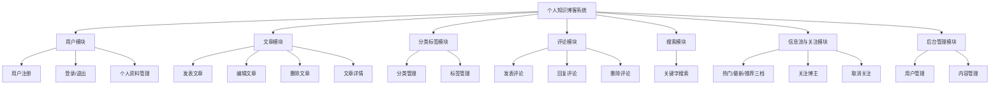
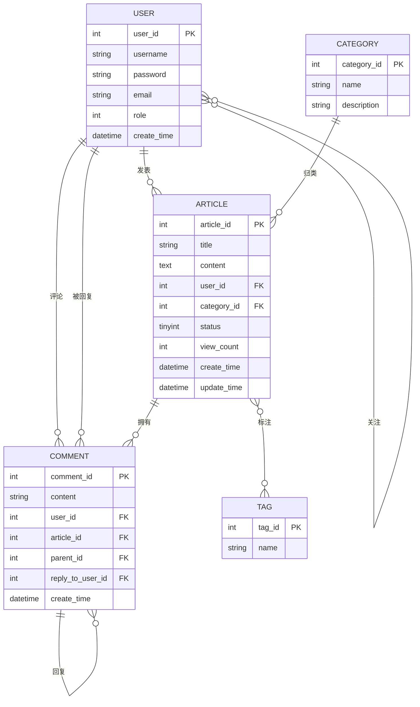

# 个人知识博客系统 — 数据库设计文档

## 一、系统功能分析

个人知识博客系统面向个人用户，提供文章撰写、分类整理、标签标注和读者互动功能。

## 二、用例分析

系统有三类参与者：**游客**（未登录访问者）、**注册用户**、**管理员**。

| 参与者 | 用例 |
|---|---|
| 游客 | 浏览文章、搜索文章、查看文章详情、查看分类、按热门/最新两档浏览首页、注册账号 |
| 注册用户 | 登录、退出、发表文章、编辑自己的文章、删除自己的文章、给文章贴/取消标签（仅自己的文章）、发表评论、回复评论、删除自己的评论、管理个人资料、修改密码、关注/取消关注其他博主、按热门/最新/推荐三档浏览首页 |
| 管理员 | 登录、管理用户（禁用/删除）、删除任意文章、修改任意文章的标签、删除任意评论、管理分类、管理标签、关注/取消关注博主（管理员身份不影响关注行为） |

说明：管理员和注册用户的权限边界在于**操作对象的所有权**——注册用户只能增删改**自己**的文章和评论，管理员可以操作**任意**文章和评论。

## 三、概念结构设计（E/R 图）

### 实体间联系说明

| 联系 | 类型 | 说明 |
|---|---|---|
| 用户 — 文章 | 1:N | 一个用户可发表多篇文章，一篇文章只有一个作者 |
| 分类 — 文章 | 1:N | 一个分类包含多篇文章，一篇文章只属于一个分类 |
| 用户 — 评论 | 1:N | 一个用户可发表多条评论 |
| 用户 — 被回复 | 1:N | 一个用户可被回复多次（`comment.reply_to_user_id`） |
| 文章 — 评论 | 1:N | 一篇文章可拥有多条评论 |
| 评论 — 评论 | 1:N | **自联系**：一条顶层评论下面可挂多条回复（`comment.parent_id`） |
| 文章 — 标签 | **M:N** | 一篇文章可有多个标签，一个标签可贴在多篇文章上 |
| 用户 — 用户 | **M:N** | **自联系**：一个用户可关注多个博主，也可被多人关注（由 `user_follow` 承载） |

> **重点 1**：本设计里有两处 **多对多（M:N）** 联系，都必须拆成独立的关联表——因为 M:N 无法直接用外键表达：
>
> | M:N 联系 | 拆出的关联表 | 为什么它必须是独立的一张表 |
> |---|---|---|
> | 文章 — 标签 | `article_tag` | `article` 表的一行放不下"多个标签"，`tag` 表的一行也放不下"多篇文章"，只能另起一张表记录两两对应 |
> | 用户 — 用户 | `user_follow` | 这是**自联系**的 M:N：一条边的两端都指向 `user`，一列存不下，只能靠两列一起表示 |
>
> 这两张中间表正是本设计有 **7 张表而非 5 张表**的原因（5 张实体表 + 2 张中间表）。

> **重点 2**：评论表有**自联系**（自己指向自己），用来表达"回复"。设计上把回复限制成**两层**：
> `parent_id` 只指向**顶层**评论，回复的回复会被归到同一个顶层评论下，不会指向另一条回复。
> 这样查一棵评论树只要一次查询再按 `parent_id` 分组，删除时一句 `WHERE parent_id = ?` 就清干净，不需要递归。
> 归一化（判断被回复的是顶层还是回复、把 parentId 提到顶层）放在 Service 层写入时做一次，读取和删除都保持简单。

## 四、逻辑结构设计（表结构）

### 1. user（用户表）

| 字段名 | 类型 | 约束 | 说明 |
|---|---|---|---|
| user_id | INT | PK, AUTO_INCREMENT | 用户ID |
| username | VARCHAR(50) | NOT NULL, UNIQUE | 用户名 |
| password | VARCHAR(100) | NOT NULL | 密码 |
| email | VARCHAR(100) | | 邮箱 |
| role | TINYINT | DEFAULT 0 | 0-普通用户 1-管理员 |
| create_time | DATETIME | DEFAULT CURRENT_TIMESTAMP | 注册时间 |

### 2. category（分类表）

| 字段名 | 类型 | 约束 | 说明 |
|---|---|---|---|
| category_id | INT | PK, AUTO_INCREMENT | 分类ID |
| name | VARCHAR(50) | NOT NULL, UNIQUE | 分类名称 |
| description | VARCHAR(255) | | 分类描述 |

### 3. tag（标签表）

| 字段名 | 类型 | 约束 | 说明 |
|---|---|---|---|
| tag_id | INT | PK, AUTO_INCREMENT | 标签ID |
| name | VARCHAR(50) | NOT NULL, UNIQUE | 标签名称 |

### 4. article（文章表）

| 字段名 | 类型 | 约束 | 说明 |
|---|---|---|---|
| article_id | INT | PK, AUTO_INCREMENT | 文章ID |
| title | VARCHAR(200) | NOT NULL | 标题 |
| content | LONGTEXT | | 正文 |
| user_id | INT | NOT NULL, FK→user | 作者ID |
| category_id | INT | FK→category | 分类ID |
| status | TINYINT | NOT NULL, DEFAULT 1 | 发布状态：0=草稿，1=已发布 |
| view_count | INT | DEFAULT 0 | 浏览量 |
| create_time | DATETIME | DEFAULT CURRENT_TIMESTAMP | 发布时间 |
| update_time | DATETIME | ON UPDATE CURRENT_TIMESTAMP | 最后修改时间 |

### 5. article_tag（文章标签关联表）

| 字段名 | 类型 | 约束 | 说明 |
|---|---|---|---|
| article_id | INT | PK(联合), FK→article | 文章ID |
| tag_id | INT | PK(联合), FK→tag | 标签ID |

> 采用 `(article_id, tag_id)` **联合主键**，从数据库层面保证同一篇文章不会重复添加同一个标签。

### 6. user_follow（用户关注关系表）

| 字段名 | 类型 | 约束 | 说明 |
|---|---|---|---|
| follower_id | INT | PK(联合), FK→user | 关注者ID（我） |
| followee_id | INT | PK(联合), FK→user | 被关注者ID（我关注的人） |
| create_time | DATETIME | DEFAULT CURRENT_TIMESTAMP | 关注时间 |

> 同样是 M:N 中间表，但和 `article_tag` 有三点不同：
>
> 1. **两个字段都指向 `user`**。这是全库唯一一张"两条外键指向同一张表"的表，所以字段名必须把方向写进去（`follower` / `followee`），
>    只叫 `user_id`、`follow_user_id` 的话，光看字段名分不清谁关注谁。
> 2. **多了一个 `create_time`**。`article_tag` 只是"文章上有这个标签"这种静态事实，
>    不需要知道什么时候贴上去的；而"关注"是一个**事件**，"我最近关注了谁"要能按时间排出来。
> 3. **有业务规则是外键管不了的**。「不能关注自己」（`follower_id = followee_id`）是行级约束，
>    外键只能保证两个 ID 各自都存在，拦不住"两个 ID 相等"；MySQL 的 `CHECK` 在 8.0.16 之前会被静默忽略。
>    所以这条规则落在 `UserFollowServiceImpl` 里，而不是指望数据库。
>
> 联合主键 `(follower_id, followee_id)` 在数据库层面挡住了"同一个人被重复关注"。

### 7. comment（评论表）

| 字段名 | 类型 | 约束 | 说明 |
|---|---|---|---|
| comment_id | INT | PK, AUTO_INCREMENT | 评论ID |
| content | VARCHAR(500) | NOT NULL | 评论内容 |
| user_id | INT | NOT NULL, FK→user | 评论人ID |
| article_id | INT | NOT NULL, FK→article | 所属文章ID |
| parent_id | INT | FK→comment | 所属顶层评论ID，NULL 表示这条本身就是顶层评论 |
| reply_to_user_id | INT | FK→user | 被回复人的用户ID，NULL 表示直接对文章评论 |
| create_time | DATETIME | DEFAULT CURRENT_TIMESTAMP | 评论时间 |

> `parent_id` 和 `reply_to_user_id` 是一对：
> `parent_id` 决定这条评论**挂在哪里**（决定树的形状），
> `reply_to_user_id` 决定这条评论**在对谁说话**（决定页面显示"回复 @某某"）。
> 只有 `parent_id` 的话，A 回复 B 之后 B 再回复 A，页面就分不清谁在跟谁说话了。
> `reply_to_user_id` 由后端根据 `parent_id` 指向的那条评论的作者推导，不接受前端传入。

## 五、设计要点小结

1. **M:N 联系的拆解**：两处多对多联系各拆出一张中间表——文章与标签用 `article_tag`，用户与用户（自联系）用 `user_follow`。两张表都用联合主键从数据库层面防止重复关联。
2. **自联系的降维**：评论的"回复"用自联系（`parent_id` 指向本表）表达，但把层级压成**两层**——回复的回复归到同一个顶层评论下。用写入时的一次归一化，换取读取和删除都不需要递归。
3. **外键完整性**：`article`、`comment`、`article_tag`、`user_follow` 四张表共建立 10 个外键约束，保证不会出现"文章作者不存在""关注了一个不存在的人"这类脏数据。其中 `user_follow` 的 2 个外键都指向 `user`，删用户时要**两个方向**一起清（`follower_id = ? OR followee_id = ?`），只清一边照样会被外键拦住。
4. **权限设计**：用 `user.role` 单字段区分普通用户和管理员，比建两张表更简单，且后续扩展角色（如编辑）只需增加枚举值。权限校验统一放在 Service 层，规则是"作者本人或管理员"。
5. **字符集**：统一 `utf8mb4`，支持中文和 emoji。
6. **引擎**：统一 `InnoDB`，支持事务和外键约束（MyISAM 不支持外键）。

---

建表脚本见同目录 `schema.sql`。
