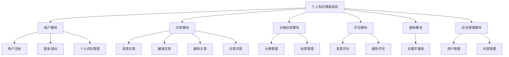
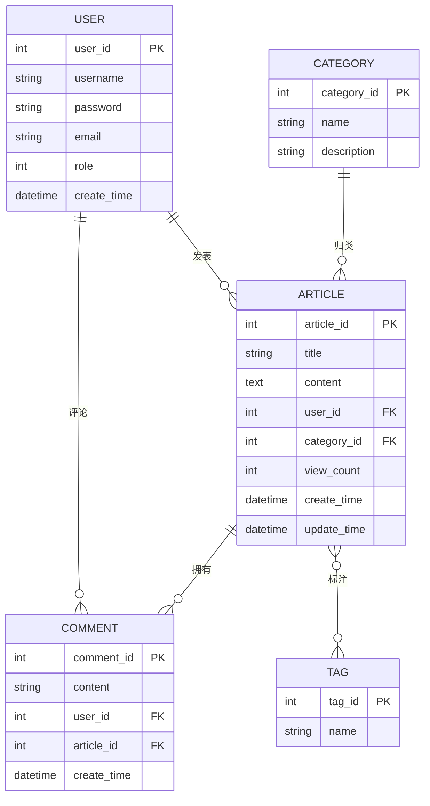

# 个人知识博客系统 — 数据库设计文档

## 一、系统功能分析

个人知识博客系统面向个人用户，提供文章撰写、分类整理、标签标注和读者互动功能。

## 二、用例分析

系统有三类参与者：**游客**（未登录访问者）、**注册用户**、**管理员**。

| 参与者 | 用例 |
|---|---|
| 游客 | 浏览文章、搜索文章、查看文章详情、查看分类、注册账号 |
| 注册用户 | 登录、退出、发表文章、编辑自己的文章、删除自己的文章、发表评论、删除自己的评论、管理个人资料、修改密码 |
| 管理员 | 登录、管理用户（禁用/删除）、删除任意文章、删除任意评论、管理分类、管理标签 |

说明：管理员和注册用户的权限边界在于**操作对象的所有权**——注册用户只能增删改**自己**的文章和评论，管理员可以操作**任意**文章和评论。

## 三、概念结构设计（E/R 图）

### 实体间联系说明

| 联系 | 类型 | 说明 |
|---|---|---|
| 用户 — 文章 | 1:N | 一个用户可发表多篇文章，一篇文章只有一个作者 |
| 分类 — 文章 | 1:N | 一个分类包含多篇文章，一篇文章只属于一个分类 |
| 用户 — 评论 | 1:N | 一个用户可发表多条评论 |
| 文章 — 评论 | 1:N | 一篇文章可拥有多条评论 |
| 文章 — 标签 | **M:N** | 一篇文章可有多个标签，一个标签可贴在多篇文章上 |

> **重点**：文章与标签是 **多对多（M:N）** 联系。在关系数据库中，M:N 联系无法直接用外键表达，必须拆分为一张独立的关联表 `article_tag`，这也是本设计中有 6 张表而非 5 张表的原因。

## 四、逻辑结构设计（表结构）

### 1. user（用户表）

| 字段名 | 类型 | 约束 | 说明 |
|---|---|---|---|
| user_id | INT | PK, AUTO_INCREMENT | 用户ID |
| username | VARCHAR(50) | NOT NULL, UNIQUE | 用户名 |
| password | VARCHAR(100) | NOT NULL | 密码 |
| email | VARCHAR(100) | | 邮箱 |
| role | TINYINT | DEFAULT 0 | 0-普通用户 1-管理员 |
| create_time | DATETIME | DEFAULT CURRENT_TIMESTAMP | 注册时间 |

### 2. category（分类表）

| 字段名 | 类型 | 约束 | 说明 |
|---|---|---|---|
| category_id | INT | PK, AUTO_INCREMENT | 分类ID |
| name | VARCHAR(50) | NOT NULL, UNIQUE | 分类名称 |
| description | VARCHAR(255) | | 分类描述 |

### 3. tag（标签表）

| 字段名 | 类型 | 约束 | 说明 |
|---|---|---|---|
| tag_id | INT | PK, AUTO_INCREMENT | 标签ID |
| name | VARCHAR(50) | NOT NULL, UNIQUE | 标签名称 |

### 4. article（文章表）

| 字段名 | 类型 | 约束 | 说明 |
|---|---|---|---|
| article_id | INT | PK, AUTO_INCREMENT | 文章ID |
| title | VARCHAR(200) | NOT NULL | 标题 |
| content | LONGTEXT | | 正文 |
| user_id | INT | NOT NULL, FK→user | 作者ID |
| category_id | INT | FK→category | 分类ID |
| view_count | INT | DEFAULT 0 | 浏览量 |
| create_time | DATETIME | DEFAULT CURRENT_TIMESTAMP | 发布时间 |
| update_time | DATETIME | ON UPDATE CURRENT_TIMESTAMP | 最后修改时间 |

### 5. article_tag（文章标签关联表）

| 字段名 | 类型 | 约束 | 说明 |
|---|---|---|---|
| article_id | INT | PK(联合), FK→article | 文章ID |
| tag_id | INT | PK(联合), FK→tag | 标签ID |

> 采用 `(article_id, tag_id)` **联合主键**，从数据库层面保证同一篇文章不会重复添加同一个标签。

### 6. comment（评论表）

| 字段名 | 类型 | 约束 | 说明 |
|---|---|---|---|
| comment_id | INT | PK, AUTO_INCREMENT | 评论ID |
| content | VARCHAR(500) | NOT NULL | 评论内容 |
| user_id | INT | NOT NULL, FK→user | 评论人ID |
| article_id | INT | NOT NULL, FK→article | 所属文章ID |
| create_time | DATETIME | DEFAULT CURRENT_TIMESTAMP | 评论时间 |

## 五、设计要点小结

1. **M:N 联系的拆解**：文章与标签的多对多联系拆出 `article_tag` 中间表，用联合主键防止重复关联。
2. **外键完整性**：`article`、`comment`、`article_tag` 三张表共建立 6 个外键约束，保证不会出现"文章作者不存在"这类脏数据。
3. **权限设计**：用 `user.role` 单字段区分普通用户和管理员，比建两张表更简单，且后续扩展角色（如编辑）只需增加枚举值。
4. **字符集**：统一 `utf8mb4`，支持中文和 emoji。
5. **引擎**：统一 `InnoDB`，支持事务和外键约束（MyISAM 不支持外键）。

---

建表脚本见同目录 `schema.sql`。
